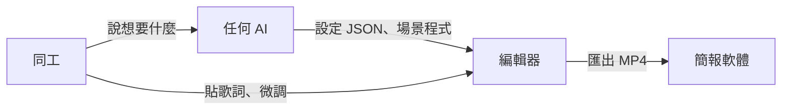
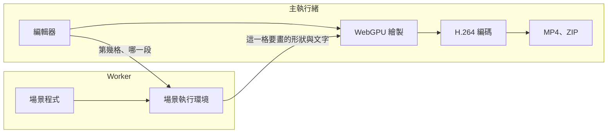
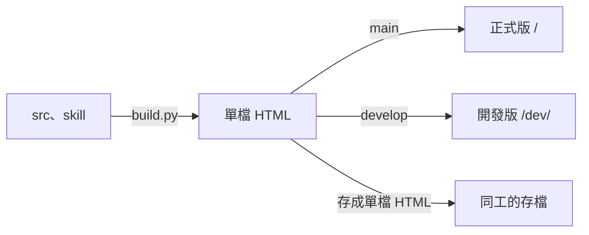

# 架構

固定的引擎，加上可換的場景程式和一份設定 JSON，打包成一個單檔 HTML，部署在 GitHub Pages。AI 只產出設定和場景程式，引擎由這個 repo 維護。

## 三種資料

| 資料 | 誰產出 | 格式 | 放哪 |
|---|---|---|---|
| 設定 | AI 或同工 | `worship-motion/1`：歌名、風格、速度、配色、各段落的背景與字幕 | 編輯器的暫存、單檔 HTML |
| 場景程式 | 這個 repo（內建）或 AI（新風格） | `defineScene({...})`：背景與字幕怎麼畫 | `src/scenes/`、`examples/`；AI 做的跟著那首歌 |
| 歌詞 | 同工自己貼 | 設定裡的 `lyrics`、`lyrics2` | 只在同工自己的暫存與存檔，不進這個 repo |

一本（多首歌）存檔時是 `worship-motion-book/1`：每首歌的設定，加上那首歌的自訂場景程式。

這三種格式的說明只有一份：`skill/SKILL.md`。它整份給 AI，也內嵌在編輯器的「複製開場白」。

## 執行時

| 部分 | 位置 | 做什麼 |
|---|---|---|
| 場景執行環境 | `src/engine/runtime.js` | 在 Worker 裡跑場景程式，每一格回傳要畫的形狀、文字圖集 |
| 繪製 | `src/engine/gpu.js` | WebGPU：形狀、質感、Canvas 圖層、自訂 WGSL |
| 自訂 WGSL 檢查 | `src/engine/shader_guard.js` | 靜態檢查（迴圈上限等），通過才編譯 |
| 影片 | `src/engine/mp4.js`、`src/engine/zip.js` | WebCodecs 編 H.264，自寫的 MP4 封裝與 ZIP |
| 編輯器 | `src/editor/` | 分頁、歷史紀錄、貼上解析、歌詞匯入、預覽、匯出 |

場景程式是外來的程式碼（AI 寫的），所以隔在 Worker 裡，並有這幾層防護：

| 風險 | 防護 |
|---|---|
| 無窮迴圈、太慢 | 每一步都有逾時；逾時就換回內建風格 |
| 自訂 WGSL 拖垮顯示卡 | 先靜態檢查，再用小畫面試跑估時間；太慢改半解析度，還是太慢就擋下 |
| 試跑時整頁當掉 | 試跑前先在暫存留標記；重開時看到標記，就不載入那個風格 |
| 顯示卡斷線 | 從目前的設定自動重建 |
| 環境不允許 Worker | 依序改用 blob、data 網址、頁面內執行 |

## 打包與部署

- `build.py` 把引擎、編輯器、內建風格、`skill/SKILL.md`、簡轉繁對照表串成一個 HTML，沒有外部依賴。
- 編輯器的「存成單檔 HTML」存出的是同一份程式，加上這本的歌。存檔本身就是完整的編輯器，離線可用。
- `.github/workflows/pages.yml`：兩個分支各自檢查與打包。一邊失敗時保留網站上那一邊的現有內容，另一邊照常更新。

## 儲存

| 資料 | 位置 | 鍵 |
|---|---|---|
| 這本的歌、歷史紀錄（每首 50 步）、存檔狀態 | localStorage | `wm:<doc>:book`、`hist`、`saved` |
| 試跑標記、說明卡是否看過 | localStorage | `wm:<channel>:probe`、`suspect`、`intro` |
| 可帶走的存檔 | 單檔 HTML | 檔案自己的 id 當 `doc` |

正式版與開發版同一個網域，用 `channel`（`main`、`dev`）分開；存成的單檔用自己的 id，互不影響。

## 對外介面

這三樣改了，AI 的產出和同工的存檔都會受影響，要連 `skill/SKILL.md`、`examples/`、測試一起改：

- 設定格式 `worship-motion/1`
- 場景 API `defineScene({...})`
- 字幕底圖 `x.under(f, 預設)`

`tests/check_repo.py` 會比對 SKILL.md 的欄位表和程式是否一致。

## 範圍

- 瀏覽器：有 WebGPU 的 Chrome、Edge。
- 輸出：1920×1080、30fps、H.264 的 MP4，沒有透明通道。
- 素材：畫面全部由程式畫出來，沒有匯入圖片、影片、字型；文字用電腦內建字型。
- 資料只在同工自己的瀏覽器和存檔裡，沒有伺服器、沒有帳號。

## 路線

目標是成為教會的產品，最後有伺服器版：每個人有自己的設定、風格、歌詞與素材。

| 階段 | 內容 | 完成時同工可以… |
|---|---|---|
| 1 歌單 | 歌曲設定（不含歌詞）成為 repo 裡一首一檔的 JSON，編輯器可以從歌單開啟 | 打開編輯器就選到教會常用的歌 |
| 2 素材 | 匯入圖片與字型；決定素材怎麼跟著存檔走 | 放教會的標誌、用指定字型 |
| 3 伺服器版 | 帳號、各自的空間、教會內共用風格與歌單 | 換電腦登入就接著做 |

動手前要先決定的事：

| 決定 | 選項 | 牽動的規則 |
|---|---|---|
| 歌詞放哪 | 只留在個人暫存與存檔；或伺服器版的私人空間 | 歌詞不進公開 repo |
| 素材怎麼存 | 內嵌進單檔；或放伺服器、單檔只記連結 | 單檔、不連網、沒有外部依賴 |
| 後端 | 靜態網站加代管的資料庫與登入服務；或自己架伺服器 | 維護人力、費用 |
| 單檔 HTML 的定位 | 伺服器版上線後仍保留，當離線版與備份；或只留匯出入 | 沒網路的場地也要能用 |
| 共用的範圍 | 整個教會一個空間；或每個小組各自一個 | 帳號與權限怎麼設計 |
