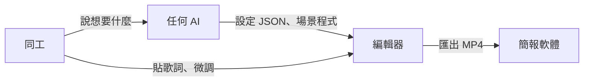
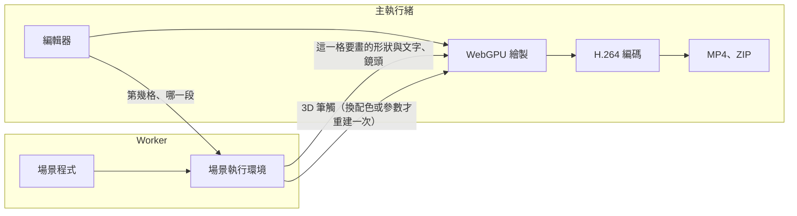
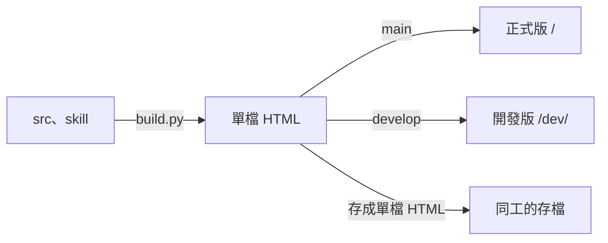

# 架構

固定的引擎，加上可換的場景程式和一份設定 JSON，打包成一個單檔 HTML，部署在 GitHub Pages。AI 只產出設定和場景程式，引擎由這個 repo 維護。

## 三種資料

| 資料 | 誰產出 | 格式 | 放哪 |
|---|---|---|---|
| 設定 | AI 或同工 | `worship-motion/1`：歌名、風格、速度、配色、各段落的背景與字幕、畫面元素的調整 | 編輯器的暫存、單檔 HTML |
| 場景程式 | 這個 repo（內建）或 AI（新風格） | `defineScene({...})`：有哪些元素、每種背景疊哪些元素、字幕怎麼畫 | `src/scenes/`、`examples/`；AI 做的跟著那首歌 |
| 歌詞 | 同工自己貼 | 設定裡的 `lyrics`、`lyrics2` | 只在同工自己的暫存與存檔，不進這個 repo |

一本（多首歌）存檔時是 `worship-motion-book/1`：每首歌的設定，加上那首歌的自訂場景程式。

這三種格式的說明只有一份：`skill/SKILL.md`。它整份給 AI，也內嵌在編輯器的「複製開場白」。

## 執行時

| 部分 | 位置 | 做什麼 |
|---|---|---|
| 場景執行環境 | `src/engine/runtime.js` | 在 Worker 裡跑場景程式，每一格回傳要畫的形狀、文字圖集、鏡頭；有 `world` 時建好 3D 筆觸、洗牌後只送一次 |
| 繪製 | `src/engine/gpu.js` | WebGPU：形狀、質感、Canvas 圖層、自訂 WGSL、3D 筆觸層 |
| 自訂 WGSL 檢查 | `src/engine/shader_guard.js` | 靜態檢查（迴圈上限等），通過才編譯 |
| 影片 | `src/engine/mp4.js`、`src/engine/zip.js` | WebCodecs 編 H.264，自寫的 MP4 封裝與 ZIP |
| 編輯器 | `src/editor/` | 分頁、歷史紀錄、貼上解析、歌詞匯入、預覽、匯出 |

### 畫面元素

畫面是一個一個元素疊起來的，同工可以單獨調整每一個，不用回去找 AI。

| 部分 | 做法 |
|---|---|
| 元素 | 場景程式在 `elements` 登記的小畫圖函式 `draw(f, x, e)`，有中文名稱、自己的參數、自己用到的配色鍵 |
| 背景 | `use` 列出要疊哪些元素（先列的在下面），可以給每個元素不同的資料 |
| 整個背景一個函式的風格 | 整個背景是一個元素「背景」（`bg`）；每個風格的字幕是一個元素「字幕」（`text`） |
| 調整 | 設定的 `elements`（整首歌）與 `sections[].elements`（只有這一段，蓋過整首歌）：`visible`、`opacity`、`params`、`colors`。只存和預設不同的值 |
| 套用 | 編輯器把這一支影片的調整交給場景執行環境。隱藏的元素不呼叫；元素自己的顏色只在它畫的期間換上；每個形狀記得自己屬於哪個元素，打包成繪製資料時乘上透明度、套上位置大小旋轉 |
| 位置、大小、旋轉 | `dx` `dy` `scale` `rotate` 是套在整個元素上的一個固定變換。軸心是元素「活動範圍」的中心：把背景的循環取樣 32 次、把畫過的地方聯集起來、裁到畫面內；字幕看最後一格。背景影片和字幕影片用同一套取樣，同一個元素在兩邊的位置才會一樣 |
| 固定的元素 | 場景標 `fixed: true` 的元素和「背景」鋪滿畫面，只能隱藏、調透明度 |
| 在預覽上操作 | 預覽上疊一層 HTML（`src/editor/stage.js`）畫選取框、把手、吸附線，WebGPU 只負責畫。點到哪個元素由場景執行環境用形狀判定（最上面的優先）；拖曳中只送調整值、不重建影片，放開才記一筆歷史紀錄 |

拆成元素的內建風格：網點印刷、大字排版。

場景程式是外來的程式碼（AI 寫的），所以隔在 Worker 裡，並有這幾層防護：

| 風險 | 防護 |
|---|---|
| 無窮迴圈、太慢 | 每一步都有逾時；逾時就換回內建風格 |
| 自訂 WGSL 拖垮顯示卡 | 先靜態檢查，再用小畫面試跑估時間；太慢改半解析度，還是太慢就擋下 |
| 3D 筆觸太多 | 一個風格最多 40 萬筆；預覽跟不上時少畫一些（筆觸洗牌過，少畫是均勻變稀），匯出一律畫滿 |
| 試跑時整頁當掉 | 試跑前先在暫存留標記；重開時看到標記，就不載入那個風格 |
| 顯示卡斷線 | 從目前的設定自動重建 |
| 環境不允許 Worker | 依序改用 blob、data 網址、頁面內執行 |

### 3D 筆觸層

畫面直接由一筆一筆筆觸構成，每一筆是固定在 3D 世界裡的一個四邊形，刷毛紋理和厚塗受光在 GPU 上畫。

| 做法 | 為什麼 |
|---|---|
| 筆觸資料只在換配色或參數時建一次，以內容當 key 快取；每一格只送鏡頭 | 幾十萬筆每格重送太慢 |
| 依筆觸在畫面上的大小決定疏密：小於 `lod` 像素就變稀、放大，再慢慢縮小消失；大小限制在 `minPx`–`maxPx` | 遠處不會糊成雜訊，也不會突然跳出來 |
| 刷毛條數固定；遠處筆觸沿視線拉開一點前後距離；反向深度配 32 位元浮點深度 | 鏡頭移動時不閃爍、不互搶前後 |
| 4 倍多重取樣＋alpha-to-coverage，不用排序 | 筆觸邊緣柔和，前後順序交給深度 |
| `keep` 的平塗筆觸（剪影墊底）排在最前面、永遠畫滿 | 筆觸之間的縫隙不露底 |

## 打包與部署

- `build.py` 把引擎、編輯器、內建風格、`skill/SKILL.md`、簡轉繁對照表串成一個 HTML，沒有外部依賴。
- 編輯器的「存成單檔 HTML」存出的是同一份程式，加上這本的歌。存檔本身就是完整的編輯器，離線可用。
- `.github/workflows/pages.yml`：兩個分支各自檢查與打包。一邊失敗時保留網站上那一邊的現有內容，另一邊照常更新。

## 儲存

| 資料 | 位置 | 鍵 |
|---|---|---|
| 這本的歌、歷史紀錄（每首 50 步）、存檔狀態 | localStorage | `wm:<doc>:book`、`hist`、`saved` |
| 試跑標記 | localStorage | `wm:<channel>:probe`、`suspect` |
| 可帶走的存檔 | 單檔 HTML | 檔案自己的 id 當 `doc` |

正式版與開發版同一個網域，用 `channel`（`main`、`dev`）分開；存成的單檔用自己的 id，互不影響。

## 對外介面

這三樣改了，AI 的產出和同工的存檔都會受影響，要連 `skill/SKILL.md`、`examples/`、測試一起改：

- 設定格式 `worship-motion/1`
- 場景 API `defineScene({...})`，包含元素的 `draw(f, x, e)` 與背景的 `use`
- 字幕底圖 `x.under(f, 預設)`

`tests/check_repo.py` 會比對 SKILL.md 的欄位表和程式是否一致。

## 範圍

- 瀏覽器：有 WebGPU 的 Chrome、Edge。
- 輸出：1920×1080、30fps、H.264 的 MP4，沒有透明通道。
- 素材：畫面全部由程式畫出來，沒有匯入圖片、影片、字型；文字用電腦內建字型。
- 元素的調整：顯示、透明度、參數、顏色、位置、大小（等比）、旋轉。動畫由場景程式決定；一次只能選一個元素。
- 資料只在同工自己的瀏覽器和存檔裡，沒有伺服器、沒有帳號。

## 路線

目標：AI 先做好九成，剩下一成同工自己微調；畫面上每個元素、每個動畫都能單獨選、單獨調、單獨加、單獨刪，AI 修改時只給那一個單元，不重寫整份風格。更遠的目標是伺服器版：每個人有自己的設定、風格、歌詞與素材。

| 階段 | 內容 | 完成時同工可以… |
|---|---|---|
| 1 元素化與清單（完成） | 風格拆成元素；元素清單；顯示、透明度、參數、顏色；整首歌或單一段落（網點印刷、大字排版） | 把不想要的東西藏起來、調淡、換色 |
| 2 直接拖（完成） | 預覽上疊一層 HTML 選取框：點選元素，拖位置、拉大小、旋轉 | 像排版軟體一樣直接擺 |
| 3 動畫單元 | 動畫拆成掛在元素上的小單元（跟拍跳、滑動、淡入…），各有參數 | 單獨換掉或調整一個元素的動法 |
| 4 AI 加元素 | AI 只回一個元素或一個動畫單元，貼進來加到這首歌；清單上可以刪除 | 說一句話請 AI 加一樣東西，不想要就刪 |
| 5 圖片元素 | 匯入圖片當元素，可拖拉、縮放、旋轉、調透明度；圖片內嵌進單檔 HTML（限制大小） | 放教會的標誌、照片 |
| 6 影片元素 | 匯入影片當元素；影片存在瀏覽器裡，存檔時另外打包成素材檔，和單檔 HTML 放一起 | 用實拍影片當底 |
| 7 其餘風格 | 其他內建風格拆成元素 | 每個內建風格都能逐個元素調 |
| 8 歌單與伺服器版 | repo 裡一首一檔的歌曲設定；帳號、各自的空間、教會內共用風格與歌單 | 打開就選到常用的歌，換電腦登入接著做 |

已經決定的事：

| 決定 | 結論 |
|---|---|
| 成品的單位 | 維持「每段一支循環背景、每句一支字幕」，給現場跟著切 |
| 設定格式 | 沿用 `worship-motion/1`，新功能都是可選欄位，舊存檔照樣能開 |
| 素材怎麼存 | 圖片內嵌進單檔 HTML；影片另存素材檔。沒有影片的歌仍然是純單檔 |
| 互動怎麼做 | HTML 疊加層處理選取與拖拉，WebGPU 只負責畫 |

動手前要先決定的事：

| 決定 | 選項 | 牽動的規則 |
|---|---|---|
| 影片怎麼逐格對準匯出 | 每一格 seek 播放器；或自己寫 MP4 解封裝加 WebCodecs 解碼 | 沒有外部依賴；匯出每格都要準 |
| 3D 筆觸的元素 | 依筆觸群組顯示與換色；位置是 3D 的，要不要能拖 | 油彩風格的可調範圍 |
| 歌詞放哪 | 只留在個人暫存與存檔；或伺服器版的私人空間 | 歌詞不進公開 repo |
| 後端 | 靜態網站加代管的資料庫與登入服務；或自己架伺服器 | 維護人力、費用 |
| 單檔 HTML 的定位 | 伺服器版上線後仍保留，當離線版與備份；或只留匯出入 | 沒網路的場地也要能用 |
| 共用的範圍 | 整個教會一個空間；或每個小組各自一個 | 帳號與權限怎麼設計 |
